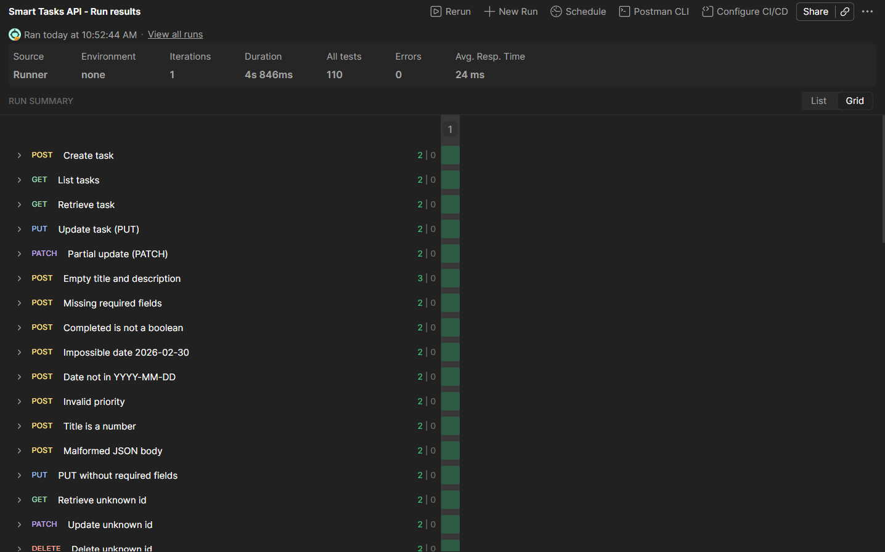
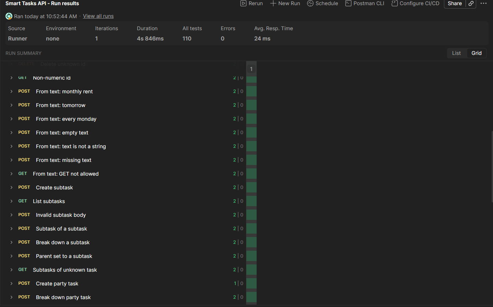
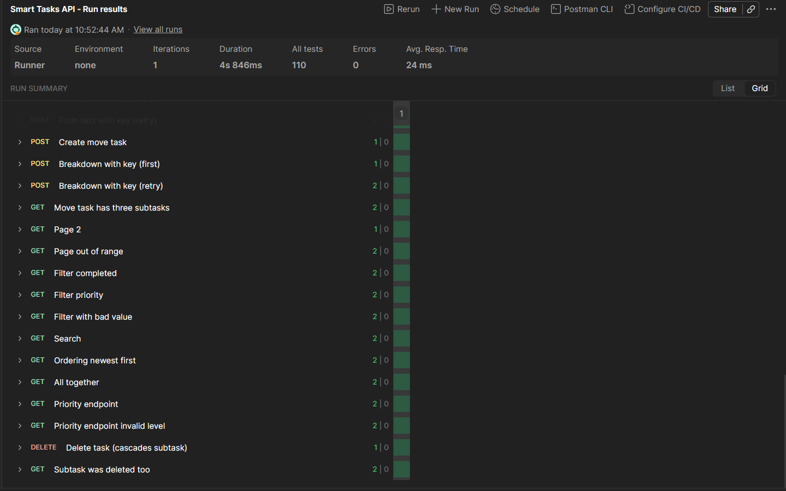
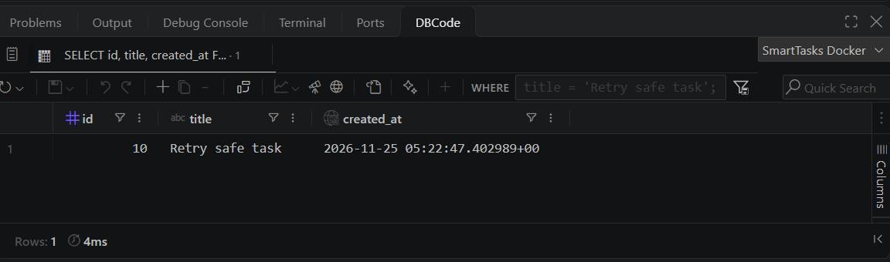
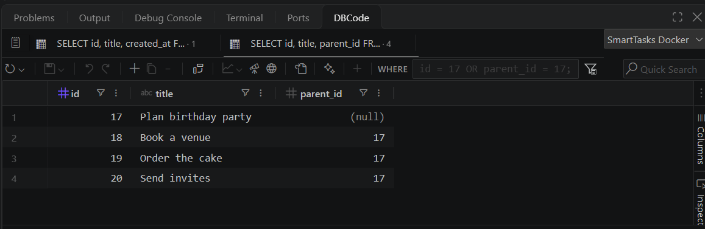
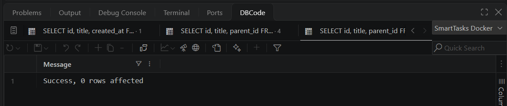
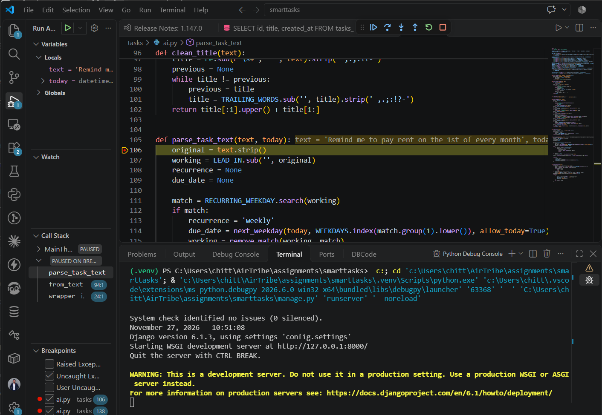
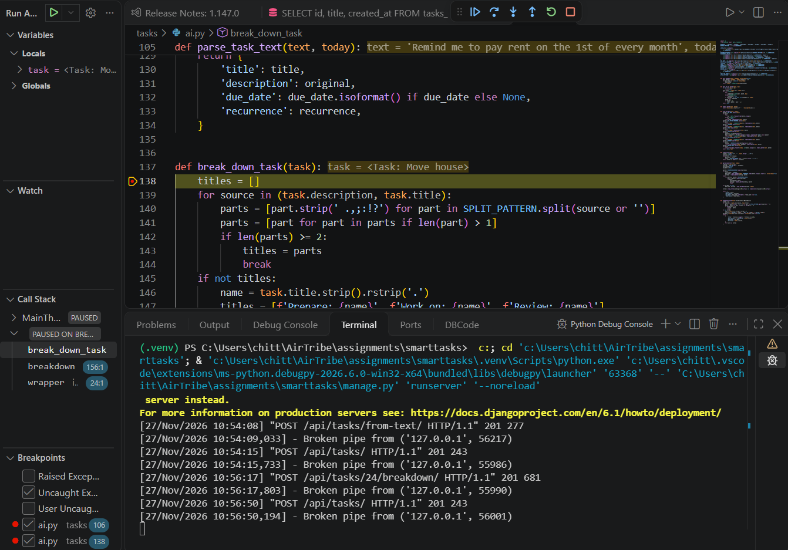
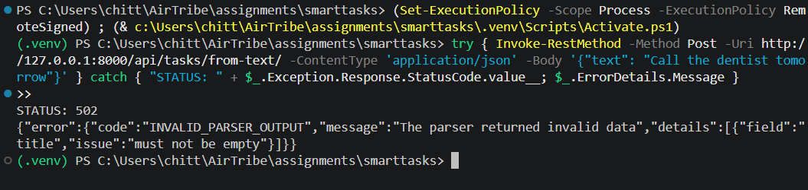

# Smart Tasks API

A REST API for tasks. You can create tasks the usual way, or type one in plain English, such as "Remind me to pay rent on the 1st of every month", and get a structured task back. Tasks can have subtasks, and a task can be broken down into subtasks automatically.

Other features:

- One error format for every 400, 404, 422 and 502 response
- Safe retries with an `Idempotency-Key` header
- Filtering, search, ordering and pagination
- Hand-written OpenAPI spec in `openapi.yaml`

Built with Django, Django REST Framework, django-filter and PostgreSQL running in Docker.

## Setup

You need Python 3.12 or newer and Docker Desktop.

1. Clone the repo and open the folder:

   ```bash
   git clone https://github.com/manideep311/smarttasks.git
   cd smarttasks
   ```

2. Create and activate a virtual environment:

   ```bash
   python -m venv .venv
   .venv\Scripts\activate
   ```

   On macOS or Linux, use `source .venv/bin/activate`.

3. Install the requirements:

   ```bash
   pip install -r requirements.txt
   ```

4. Start PostgreSQL in Docker:

   ```bash
   docker compose up -d
   ```

   The database listens on port **5433** so it doesn't clash with a local PostgreSQL install on 5432. Connect your DB client with host `localhost`, port `5433`, database `smarttasks`, user `postgres`, password `postgres`.

5. Create the tables and start the server:

   ```bash
   python manage.py migrate
   python manage.py runserver
   ```

The API is at `http://127.0.0.1:8000/api/`.

### Configuration

Settings are read from environment variables, with defaults that match `docker-compose.yml`:

| Variable | Default |
|---|---|
| `POSTGRES_DB` | `smarttasks` |
| `POSTGRES_USER` | `postgres` |
| `POSTGRES_PASSWORD` | `postgres` |
| `POSTGRES_HOST` | `localhost` |
| `POSTGRES_PORT` | `5433` |
| `DJANGO_SECRET_KEY` | development key |
| `DJANGO_DEBUG` | `True` |

The text parser is rule-based, so no `LLM_API_KEY` is needed. `.env` is listed in `.gitignore` so local secrets never get committed.

## Error format

Every error response has the same shape. `code` and `message` are always strings.

```json
{
  "error": {
    "code": "VALIDATION_ERROR",
    "message": "Validation failed",
    "details": [{ "field": "title", "issue": "must not be empty" }]
  }
}
```

| Status | Code | When |
|---|---|---|
| 400 | `VALIDATION_ERROR` | A field breaks a rule, or a filter value is invalid |
| 400 | `PARSE_ERROR` | The request body is not valid JSON |
| 400 | `SUBTASK_NOT_ALLOWED` | Adding subtasks to, or breaking down, a task that is already a subtask |
| 404 | `NOT_FOUND` | No task with that id, an unknown URL under `/api/`, or a page number past the end |
| 405 | `METHOD_NOT_ALLOWED` | The URL exists but not for that method |
| 422 | `IDEMPOTENCY_KEY_REUSED` | An `Idempotency-Key` was reused with a different body |
| 502 | `PARSER_ERROR`, `INVALID_PARSER_OUTPUT` | The text parser crashed or returned data that failed validation |
| 502 | `BREAKDOWN_ERROR`, `INVALID_BREAKDOWN_OUTPUT` | The breakdown crashed or returned invalid subtasks |

Validation rules:

- `title` and `description` are required, must be strings and must not be empty. `title` is at most 200 characters.
- `completed` must be `true` or `false`. Strings like `"yes"` are rejected.
- `due_date` is optional. When given, it must be a real date in `YYYY-MM-DD` format, so `2026-02-30` is rejected.
- `priority` must be `low`, `medium` or `high`. It defaults to `medium`.
- `parent` must be the id of a task that is not itself a subtask.

## Endpoints

| Method | URL | Purpose |
|---|---|---|
| GET | `/api/tasks/` | List tasks |
| POST | `/api/tasks/` | Create a task (201) |
| GET | `/api/tasks/{id}/` | Retrieve one task |
| PUT / PATCH | `/api/tasks/{id}/` | Update a task |
| DELETE | `/api/tasks/{id}/` | Delete a task and its subtasks (204) |
| POST | `/api/tasks/from-text/` | Create a task from plain English (201) |
| GET | `/api/tasks/{id}/subtasks/` | List a task's subtasks |
| POST | `/api/tasks/{id}/subtasks/` | Create one subtask (201) |
| POST | `/api/tasks/{id}/breakdown/` | Split a task into subtasks (201) |
| GET | `/api/tasks/priority/{level}/` | List tasks with one priority |

### Create a task

`POST /api/tasks/`

```json
{
  "title": "Pay rent",
  "description": "Transfer rent to the landlord",
  "priority": "high",
  "due_date": "2026-12-01"
}
```

Response `201 Created`:

```json
{
  "id": 1,
  "title": "Pay rent",
  "description": "Transfer rent to the landlord",
  "completed": false,
  "due_date": "2026-12-01",
  "priority": "high",
  "parent": null,
  "created_at": "2026-11-25T04:49:46.505300Z",
  "updated_at": "2026-11-25T04:49:46.505309Z"
}
```

### Validation error

`POST /api/tasks/`

```json
{
  "title": "",
  "description": "Rent",
  "completed": "yes",
  "due_date": "2026-02-30",
  "priority": "urgent"
}
```

Response `400 Bad Request`:

```json
{
  "error": {
    "code": "VALIDATION_ERROR",
    "message": "Validation failed",
    "details": [
      { "field": "title", "issue": "must not be empty" },
      { "field": "completed", "issue": "must be a boolean" },
      { "field": "due_date", "issue": "must be a real date in YYYY-MM-DD format" },
      { "field": "priority", "issue": "must be one of low, medium, high" }
    ]
  }
}
```

### List tasks

`GET /api/tasks/?search=rent&priority=high&completed=true&ordering=-created_at&page=1`

Filters, search, ordering and pagination all work in the same request. Pages hold 10 tasks.

| Parameter | Example | Effect |
|---|---|---|
| `page` | `?page=2` | Page number |
| `completed` | `?completed=true` | Only finished or unfinished tasks |
| `priority` | `?priority=high` | Only one priority |
| `search` | `?search=rent` | Matches title and description |
| `ordering` | `?ordering=-created_at` | Sort by `created_at`, `updated_at`, `due_date` or `title`. A leading `-` means descending. |

Response `200 OK`:

```json
{
  "count": 1,
  "next": null,
  "previous": null,
  "results": [
    {
      "id": 1,
      "title": "Pay rent",
      "description": "Transfer rent to the landlord",
      "completed": true,
      "due_date": "2026-12-01",
      "priority": "high",
      "parent": null,
      "created_at": "2026-11-25T04:49:46.505300Z",
      "updated_at": "2026-11-25T04:49:46.567910Z"
    }
  ]
}
```

### Retrieve a task

`GET /api/tasks/1/`

Response `200 OK`:

```json
{
  "id": 1,
  "title": "Pay rent",
  "description": "Transfer rent to the landlord",
  "completed": false,
  "due_date": "2026-12-01",
  "priority": "high",
  "parent": null,
  "created_at": "2026-11-27T05:41:52.348695Z",
  "updated_at": "2026-11-27T05:41:52.348706Z"
}
```

An unknown id returns `404 Not Found`:

```json
{
  "error": {
    "code": "NOT_FOUND",
    "message": "Task not found",
    "details": [{ "field": "id", "issue": "no task with id 99" }]
  }
}
```

### Replace a task

`PUT /api/tasks/1/` needs every required field.

```json
{
  "title": "Pay rent",
  "description": "Rent for December",
  "completed": false,
  "due_date": "2026-12-01",
  "priority": "high"
}
```

Response `200 OK`:

```json
{
  "id": 1,
  "title": "Pay rent",
  "description": "Rent for December",
  "completed": false,
  "due_date": "2026-12-01",
  "priority": "high",
  "parent": null,
  "created_at": "2026-11-27T05:41:52.348695Z",
  "updated_at": "2026-11-27T05:41:52.398877Z"
}
```

### Update some fields

`PATCH /api/tasks/1/` changes only the fields you send.

```json
{ "completed": true }
```

Response `200 OK`:

```json
{
  "id": 1,
  "title": "Pay rent",
  "description": "Rent for December",
  "completed": true,
  "due_date": "2026-12-01",
  "priority": "high",
  "parent": null,
  "created_at": "2026-11-27T05:41:52.348695Z",
  "updated_at": "2026-11-27T05:41:52.420161Z"
}
```

### Delete a task

`DELETE /api/tasks/1/` (no body)

Response `204 No Content`, with an empty body. The task's subtasks are deleted with it.

### Unknown URL

`GET /api/nothing/`

Response `404 Not Found`:

```json
{
  "error": {
    "code": "NOT_FOUND",
    "message": "Endpoint not found",
    "details": [{ "field": "path", "issue": "no endpoint at /api/nothing/" }]
  }
}
```

### Create a task from text

`POST /api/tasks/from-text/`

```json
{ "text": "Remind me to pay rent on the 1st of every month" }
```

Response `201 Created`:

```json
{
  "id": 2,
  "title": "Pay rent",
  "description": "Remind me to pay rent on the 1st of every month",
  "completed": false,
  "due_date": "2026-12-01",
  "priority": "medium",
  "parent": null,
  "created_at": "2026-11-25T04:49:46.586760Z",
  "updated_at": "2026-11-25T04:49:46.586774Z",
  "recurrence": "monthly"
}
```

The parser output goes through `TaskSerializer` before anything is saved, exactly like user input. If the parser crashes, or returns data that fails validation, the API returns `502` in the error format and saves nothing. An empty or missing `text` returns `400`.

### Subtasks

`POST /api/tasks/1/subtasks/`

```json
{ "title": "Check bank balance", "description": "Make sure there is enough money" }
```

Response `201 Created`:

```json
{
  "id": 3,
  "title": "Check bank balance",
  "description": "Make sure there is enough money",
  "completed": false,
  "due_date": null,
  "priority": "medium",
  "parent": 1,
  "created_at": "2026-11-25T04:49:46.618172Z",
  "updated_at": "2026-11-25T04:49:46.618182Z"
}
```

`GET /api/tasks/1/subtasks/` lists the subtasks, oldest first.

Response `200 OK`:

```json
[
  {
    "id": 3,
    "title": "Check bank balance",
    "description": "Make sure there is enough money",
    "completed": false,
    "due_date": null,
    "priority": "medium",
    "parent": 1,
    "created_at": "2026-11-25T04:49:46.618172Z",
    "updated_at": "2026-11-25T04:49:46.618182Z"
  }
]
```

A subtask can't have its own subtasks. `POST /api/tasks/3/subtasks/` returns `400 Bad Request`:

```json
{
  "error": {
    "code": "SUBTASK_NOT_ALLOWED",
    "message": "A subtask cannot have its own subtasks",
    "details": [{ "field": "id", "issue": "task 3 is already a subtask of task 1" }]
  }
}
```

### Break down a task

`POST /api/tasks/4/breakdown/` (no body), for a task with the description "Book a venue, order the cake and send invites".

Response `201 Created`:

```json
[
  { "id": 5, "title": "Book a venue", "description": "Subtask of \"Plan birthday party\"", "completed": false, "due_date": "2026-12-20", "priority": "medium", "parent": 4, "created_at": "...", "updated_at": "..." },
  { "id": 6, "title": "Order the cake", "description": "Subtask of \"Plan birthday party\"", "completed": false, "due_date": "2026-12-20", "priority": "medium", "parent": 4, "created_at": "...", "updated_at": "..." },
  { "id": 7, "title": "Send invites", "description": "Subtask of \"Plan birthday party\"", "completed": false, "due_date": "2026-12-20", "priority": "medium", "parent": 4, "created_at": "...", "updated_at": "..." }
]
```

Every item is validated before any is saved. If one is invalid, none are saved and the API returns `502`. Breaking down a subtask returns `400 SUBTASK_NOT_ALLOWED`.

### Tasks by priority

`GET /api/tasks/priority/high/` returns a page of high-priority tasks. Search, filters, ordering and `page` work here too.

Response `200 OK`:

```json
{
  "count": 1,
  "next": null,
  "previous": null,
  "results": [
    {
      "id": 1,
      "title": "Pay rent",
      "description": "Transfer rent to the landlord",
      "completed": true,
      "due_date": "2026-12-01",
      "priority": "high",
      "parent": null,
      "created_at": "2026-11-25T04:49:46.505300Z",
      "updated_at": "2026-11-25T04:49:46.567910Z"
    }
  ]
}
```

`GET /api/tasks/priority/urgent/` returns `400 Bad Request`:

```json
{
  "error": {
    "code": "VALIDATION_ERROR",
    "message": "Validation failed",
    "details": [{ "field": "level", "issue": "must be one of low, medium, high" }]
  }
}
```

## Idempotency

`POST /api/tasks/`, `POST /api/tasks/from-text/` and `POST /api/tasks/{id}/breakdown/` accept an optional `Idempotency-Key` header.

- Same key and same body: the stored response comes back, and nothing new is created. The parser is not called again.
- Same key with a different body: `422` with code `IDEMPOTENCY_KEY_REUSED`.
- Only successful responses are stored, so after a `400` you can fix the body and retry with the same key.

Keys live in a module-level dictionary in `tasks/idempotency.py`, so they reset when the server restarts.

To check it, send the same request twice with the same key, then count the rows:

```bash
docker exec smarttasks-db psql -U postgres -d smarttasks -c "select count(*) from tasks_task where title = 'Retry safe task';"
```

## Swappable text functions

Both functions live in `tasks/ai.py` and are rule-based. Either can be replaced with an LLM call, as long as it keeps the same signature and return shape. The views treat their output as untrusted and validate it.

```python
parse_task_text(text: str, today: datetime.date) -> dict
```

Returns `title`, `description`, `due_date` (a `YYYY-MM-DD` string or `None`) and `recurrence` (`"daily"`, `"weekly"`, `"monthly"`, `"yearly"` or `None`). It understands phrases such as "tomorrow", "today", "in 3 days", "next week", weekday names, "the 1st", "every month" and "every monday".

```python
break_down_task(task: Task) -> list[dict]
```

Returns one dictionary per subtask, with `title`, `description`, `due_date` and `priority`. It splits the description, or the title, on commas, semicolons, "and" and "then". If neither splits, it uses a prepare, work on, review template.

## Testing

The Postman collection is in `postman/smarttasks.postman_collection.json`. Import it into Postman and run the whole collection. Every request has tests for its status code and, for errors, the error format. The `baseUrl` variable defaults to `http://127.0.0.1:8000/api`.

### What the first checklist missed

The first draft of the test checklist came from an AI assistant. It covered the happy path for CRUD, from-text, subtasks and breakdown, plus one empty-title check. It missed:

- An impossible date (`2026-02-30`) and dates in other formats
- Wrong JSON types, such as a number for `title` or `"yes"` for `completed`
- Malformed JSON bodies
- Unknown and non-numeric ids on update and delete, not only on retrieve
- A subtask of a subtask, breaking down a subtask, and setting `parent` to a subtask
- The same `Idempotency-Key` with a different body
- A failed request retried with the same key after fixing the body
- A page number past the end and invalid filter values
- Bad parser output (an empty title, wrong types) which must return `502` and save nothing

All of these are now in the collection. Running them led to three changes:

- Strict type checks for `title`, `description`, `completed` and `due_date`, because by default numbers were accepted as titles and `"yes"` as a boolean.
- An exception handler so errors raised by the framework (bad JSON, bad filter values, unknown pages, wrong methods) use the same error format.
- A check on the parser's `recurrence` value, so the parser output is never trusted.

To test bad parser output by hand, temporarily change `parse_task_text` to return `{"title": "", "description": "x", "due_date": None}`. `POST /api/tasks/from-text/` then returns `502` with `INVALID_PARSER_OUTPUT`, and no row is added.

## Proof

### Postman run

A full run of the Postman collection, with 110 tests passed and 0 errors.







### Idempotency

The table holds one `Retry safe task` row, even though the request was sent twice with the same `Idempotency-Key`.



### Cascade delete

A parent task with its three subtasks from `breakdown`, then the same query after `DELETE /api/tasks/17/`, which removed all four rows.





### Debugging

The debugger paused inside `parse_task_text` and `break_down_task`, with the request data in the Variables panel.





### Bad parser output

With `parse_task_text` changed to return an empty title, `POST /api/tasks/from-text/` returns `502` with `INVALID_PARSER_OUTPUT` and saves nothing.


